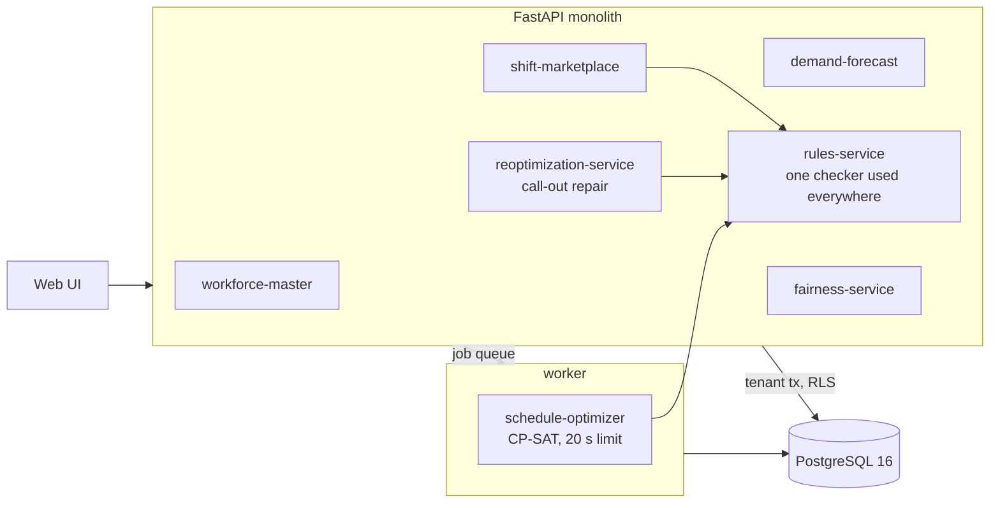

# Intelligent Workforce Scheduling & Labor Optimization Engine

Forecasts how many people a store needs every half hour, builds a week's schedule that obeys the labor rules at the lowest
cost, repairs it with the fewest changes when people call in sick, and validates shift swaps automatically.

Built from blueprint 9 of an "Enterprise SaaS + AI" build book as a **vertical slice**: the demo scenario end to end, with the
platform parts real and the rest listed under [Not built](#not-built-and-why).

**Every store, worker and sale is synthetic. The labor rules are a generic pack, not any jurisdiction's law.**

## Run it

```bash
docker compose up --build        # migrates, seeds 50 stores and 5,000 workers, serves http://localhost:8109/ui/
docker compose run --rm test     # 34 tests against a throwaway database (the end-to-end test runs the real solver, about 25 s)
```

Open http://localhost:8109/ui/ and press **Run all steps**, or `make bootstrap demo`. API docs at `/docs`.
Demo tokens (local only): `acme-scheduler-demo`, `acme-viewer-demo`, `acme-admin-demo`.

## The demo, step by step

1. Forecast next week for one store (61 workers). Saturday carries a promotion and last Saturday did not: forecast 3,805 transactions against 3,025 last week, so 33 people at peak, not 28.
2. A constraint solver assigns 241 shifts from 21,182 yes / no decisions in 20 seconds, within 0.3% of the best possible. An independent checker finds 0 rule violations.
3. Against a first-fit schedule of the same week: labor cost $29,121 against $33,908 (-14.1%), demand covered 99.9% against 92.8%, preference score 92.9 against 74.9.
4. Two people working the Saturday evening peak call in sick, a cashier and a service desk worker: hours short go from 1.0 to 11.5.
5. Four people can legally take the cashier shift (ranked). Nobody can take the service desk shift: of 59 others, 34 are already working, 7 have a lapsed certificate, and the rest are unavailable, over hours or under-rested. A repair solve closes the gap in 0.4 s by changing 3 of 45 assignments.
6. A Sunday shift is offered on the marketplace. The first claim is refused with `CERT_EXPIRED`; the second passes all 8 rules and the shift moves.
7. Overtime, weekend load and contracted hours: first-fit, the schedule as published, and as it stands after the call-outs and the swap.

## Architecture



| Piece | How it works |
|---|---|
| Forecast | Per store: learn the promotion uplift and rain effect from a year of history, strip them out, average the last six same-weekdays slot by slot, apply half of the last month's trend, put the forecast day's drivers back. A staffing standard turns transactions into people per skill. |
| Rule pack | One file, `ws/rules.py`: qualification, valid certificate, availability, one shift a day, 11 hours of rest, weekly maximum, a day off, allowed shift shapes with an unpaid break in long shifts. The solver encodes these as constraints; the same file then re-checks the solver's output, ranks replacements and validates marketplace claims. |
| Schedule solver | CP-SAT. One yes / no variable per worker, day, start hour, length (4 h, 6 h, 8.5 h) and skill. Hard: the rule pack. Soft, in dollars: understaffing ($60 per person-half-hour), wages with overtime premium, hours at times the worker asked to avoid, contracted hours not given (three times dearer below half), weekend shifts for people who just worked several. |
| Repair | Same model for one day. Every other day is frozen, called-out workers are removed, and each changed assignment costs $30, so the solver changes the smallest set that closes the gap. |
| Replacement ranking | Everyone the rule pack allows, ordered by added pay including overtime, stated dislike of the time, recent weekend load and contracted-hours shortfall; everyone else counted by the rule that blocks them. |
| Marketplace | An offer, then a claim that is checked against the full rule pack in the claim's transaction. Refusals are audited too. |
| Platform | Row-level security per tenant, Postgres job queue for the weekly solve, idempotency keys, hash-chained audit log, `/metrics`, RFC 7807 errors. |

## Data model

`migrations/002_workforce.sql` follows the blueprint (locations, workers, skills, worker_skills, availability, demand_intervals,
shifts, assignments, rule_violations, schedule_runs, shift_market_orders); additions are marked `(+)`: `demand_days` (history and
drivers) and `callouts`.

## API

| Method | Endpoint | Purpose |
|---|---|---|
| POST | `/v1/demand:forecast` | Generate staffing demand intervals for a store's week |
| POST | `/v1/schedules:optimize` | 202 + job: solve the schedule |
| GET | `/v1/schedules/{id}` | Schedule, costs, coverage and violations |
| POST | `/v1/callouts` | Record a call-out and the gap it opens |
| GET | `/v1/callouts/{id}/replacements` | Rank legal replacement candidates |
| POST | `/v1/shift-market/orders` | Offer a shift |
| POST | `/v1/shift-market/orders/{id}:claim` | Claim after constraint validation |
| GET | `/v1/fairness` | Hours, weekend and overtime fairness metrics |
| POST | `/v1/schedules/{id}:repair` | (+) Minimal-disruption repair of a day's open call-outs |
| GET | `/v1/locations` · `/v1/schedules/{id}/shifts` · `/v1/shift-market/orders/{id}/candidates` | (+) Lookups |

Contract: [`docs/openapi.json`](docs/openapi.json).

## Measured

[`docs/evaluation.md`](docs/evaluation.md) (`python -m ws.evaluate`) and [`docs/performance.md`](docs/performance.md).

| Component | Result | Baseline |
|---|---|---|
| Forecast error, daily totals, 50 stores x 12 weeks | 4.4% | same weekday last week: 10.3% |
| Forecast error, half-hour level | 8.1% | 14.0% |
| Week labor cost, six stores | $180,894 | first-fit: $213,371 (solver is 15.2% lower) |
| Hours short of demand, six stores | 5.5 | first-fit: 428.5 |
| Hours at times people asked to avoid | 444 | first-fit: 2,302 |
| Rule violations found by the independent checker | 0 | first-fit: 0 |
| Schedule built on the model forecast, scored on actual demand | 8.5 hours short | built on last week's copy: 22.5 |
| Call-out repair, 25 trials of two call-outs | median 2 assignments changed, gap closed, 0.3 s | re-solving the day freely: 34 changed |

First-fit is a fair but simple baseline: it obeys the same rules and balances hours, but never revisits a choice. An experienced
manager would beat it, so 15% is an upper estimate of what the solver adds, not a forecast for a real store.

## The hardest tradeoff

Cost against contracted hours. The store needs about 1,250 staff-hours in the week and its 61 people are contracted for about
1,600. First-fit pays for 1,558 hours, 400 of them beyond demand. The solver pays for 1,370, and the 188 hours it removed were hours
somebody was expecting: total hours below contract rise from 128 to 264. The first version of the objective made this worse than it
needed to be, because a flat penalty per missing hour let the solver pile the whole shortfall onto a few expensive people (8 of 61
below half their contracted hours). The penalty is now three times steeper below half, which spreads the shortfall (2 of 61 below
half) for about 1% more labor cost. How much a missing contracted hour should cost is a policy decision, not a technical one; it is
one number, `W_TARGET` in `ws/solver.py`, and the fairness endpoint reports the consequence either way so nobody has to guess.

## Threat model (summary)

| Threat | Mitigation here | Gap |
|---|---|---|
| One company seeing another's workers or schedules | Row-level security on locations, workers, skills and schedule runs; shifts, call-outs and orders are reached only through them; tested with a second tenant across every endpoint | Shifts and assignments rely on the join to their run |
| An illegal swap slipping through | Claims are validated against the whole rule pack inside the claim's transaction, with the order row locked; refused claims change nothing (tested) | No worker login: a scheduler acts for workers |
| The solver producing an illegal schedule | Every schedule is re-checked by the independent rule checker and violations are stored; tests re-check from database rows | The checker and solver share the rule constants |
| Disputes about who changed what | Publications, call-outs, repairs, offers, claims and refusals are audited in a hash chain with solver and rule-pack versions | No external anchor |
| Worker personal data | Names and employee numbers only; no contact details stored | No field-level encryption |

## Not built, and why

- **Real labor law.** The rule pack is generic (11 h rest, weekly maximum, one break). Minor-labor rules, predictive-scheduling premiums, meal-break timing windows and union rules differ by place and were not modelled.
- **Time zones and daylight saving.** Times are stored as UTC wall-clock for one zone.
- **Large stores.** Solved only at 61 to 69 workers; see performance.md.
- **Timeclock integration, notifications, worker mobile app or login.**
- **Hierarchical forecasting, weather or event feeds, 15-minute grain.** One store-level model with two binary drivers.
- **Multi-week fairness.** Weekend history is an input number per worker, not derived from past schedules.
- **Swaps between two workers** (only offer and pick-up), demand-shock and policy what-if simulation.
- **Kafka, Redis, OpenTelemetry, Grafana, Terraform, CI, SSO, a Next.js front end**: not needed to prove the slice; no cloud account used.

## Commercial sketch

Buyer: operations leaders at hospitals, hotels, restaurants, retailers, warehouses and call centers. Pricing shape from the
blueprint: per active worker per month with a location minimum; labor-law packs and the forecasting module as add-ons. The UI's
"What is it worth?" panel uses this store's weekly labor cost with an assumed 3% saving and an assumed price.

## Layout

```
core/        platform kit: db + RLS, jobs, audit chain, HTTP, scenario runner, load test
ws/          world (synthetic retailer), forecast, rules (the rule pack), solver (CP-SAT schedule + repair, first-fit baseline), store, api, seed, evaluate
migrations/  forward-only SQL          web/   UI, scenario.json, demo.json (recorded run)
tests/       34 tests                  docs/  evaluation.md, performance.md, openapi.json
```
